# Olist E-Commerce Analysis (SQL)

SQL analysis of the Olist Brazilian e-commerce dataset using PostgreSQL.

## Dataset
- Source: Kaggle, "Brazilian E-Commerce Public Dataset by Olist"
- 9 CSV files; 8 are loaded so far (the geolocation file is not used yet)
- Rows: orders 99,441, customers 99,441, order_items 112,650, order_payments 103,886, order_reviews 99,224, products 32,951, sellers 3,095, category translations 71

## Tools
PostgreSQL 18, pgAdmin 4

## Project Workflow

## How the Tables Connect
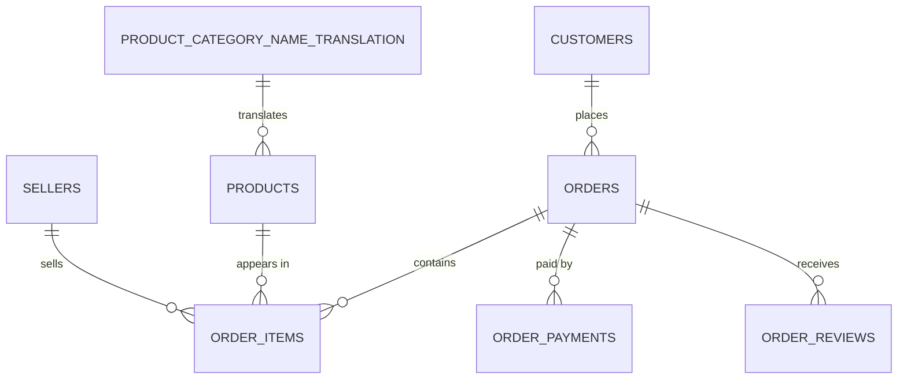

## Files
- `01_create_tables.sql`: table definitions
- `02_data_cleaning.sql`: data quality checks
- `03_cleaning_fixes.sql`: fixes for the problems found

## Data Quality Checks and Fixes

**1. Repeated review IDs** (`check1.png`, `check5.png`)
99,224 review rows have only 98,410 unique review IDs, and 547 orders have more than one review. Fix: the view `order_reviews_clean` keeps the latest review per order, giving 98,673 orders with exactly one review each (`verify1.png`).

**2. Missing delivery dates** (`check2.png`)
Orders by status: delivered 96,478, shipped 1,107, canceled 625, unavailable 609, invoiced 314, processing 301, created 5, approved 2. Most orders that were not delivered have no delivery date, which is expected. Two oddities: 8 delivered orders have no delivery date, and 6 canceled orders do have one. Handling: delivery-time analysis will use only delivered orders that have a delivery date.

**3. Product categories without English names** (`check3.png`)
610 products (about 1.9%) have no category at all, and 13 products belong to 2 categories with no translation (`portateis_cozinha_e_preparadores_de_alimentos` and `pc_gamer`). Fix: added the two missing translations, translated manually (`verify2.png`). The 610 uncategorized products will be labeled `unknown` inside queries.

**4. Order items without a matching order** (`check4.png`)
None found (0 orphan items).

## Business Questions

### Q1: How do revenue and orders change month by month?
See `04_q1_monthly_revenue.sql`.

**Method:** Delivered orders only. Revenue is the sum of item prices in Brazilian reais, excluding freight. Each order is counted once with `COUNT(DISTINCT order_id)`.

**Finding:** The data has only three months in 2016 (Sep, Oct and Dec, with 1, 265 and 1 orders, and none in Nov), so those months and the percentage changes around them (over 1,000,000% in Jan 2017) are not meaningful. From Jan 2017, orders grew from 750 to 7,069 in Jan 2018, and revenue from about 112K to about 925K. The peak month was Nov 2017 with 7,289 orders and 987,765 in revenue (+52.4% on Oct 2017), followed by a 26.5% drop in Dec 2017. The data alone cannot explain the November spike. From Jan to Aug 2018, monthly revenue stayed between about 826K and 978K, so growth leveled off. Revenue per order stayed between about 124 and 149 from Jan 2017 on, so growth came from more orders rather than larger orders. Delivered orders in the data end in Aug 2018.

### Q2: Which product categories earn the most revenue?
See `05_q2_category_revenue.sql`.

**Method:** Delivered orders only. Revenue is the sum of item prices excluding freight. Category names were translated to English, and products with no category are grouped as `unknown`. Each category's share is calculated against revenue from all categories.

**Finding:** The top 10 categories earn about 62% of total revenue. health_beauty ranks first (1,233,132, 9.3% of total), followed by watches_gifts (1,166,177, 8.8%) and bed_bath_table (1,023,435, 7.7%). bed_bath_table sold the most items (10,953) but ranks third in revenue, while watches_gifts sold only 5,859 items and ranks second, so watches_gifts items cost more on average (roughly 199 per item against 93, calculated from these figures). Ranks 4 to 10 are sports_leisure, computers_accessories, furniture_decor, housewares, cool_stuff, auto and toys.

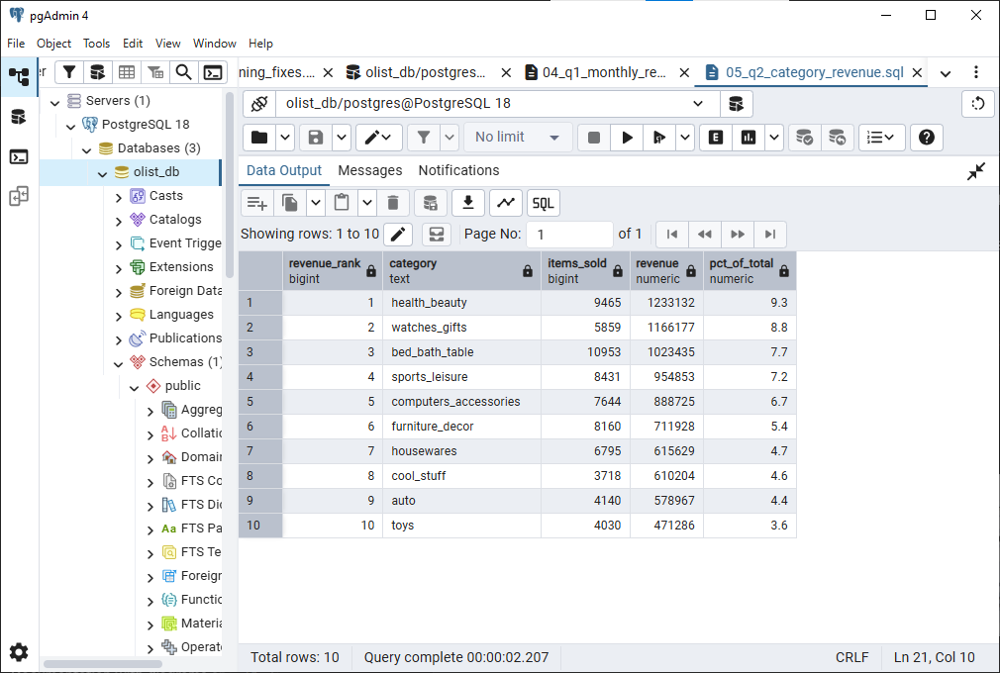

### Q3: How long does delivery take, and what share of orders arrive late?
See `06_q3_delivery.sql`.

**Method:** Delivered orders that have a delivery date (96,470 orders; the 8 delivered orders with no delivery date are excluded). Delivery time is the number of days from purchase to delivery to the customer. An order counts as late if it arrived after the estimated delivery date.

**Finding:** Average delivery time was 12.6 days and the median was 10.2 days, so a minority of slow deliveries pull the average up. 7,826 orders (about 8.1%) arrived late. In 2017 the monthly late share was between about 3% and 8.4%, except in Nov 2017 (the busiest month), when it reached 14.3% and average delivery time rose to 15.2 days. It reached 16.0% in Feb 2018 and 21.4% in Mar 2018, the highest of any month with meaningful volume, then fell to 5.3% in Apr 2018 and 1.4% in Jun 2018. In Aug 2018 the average delivery time was the shortest (7.7 days), but 10.4% of orders were still late, so the late share does not move one-to-one with delivery time. The data alone cannot explain these changes. The 2016 months have too few orders to interpret. Monthly order counts can differ from Q1 by a few orders, because Q1 counts all delivered orders and this query counts only those with a delivery date.

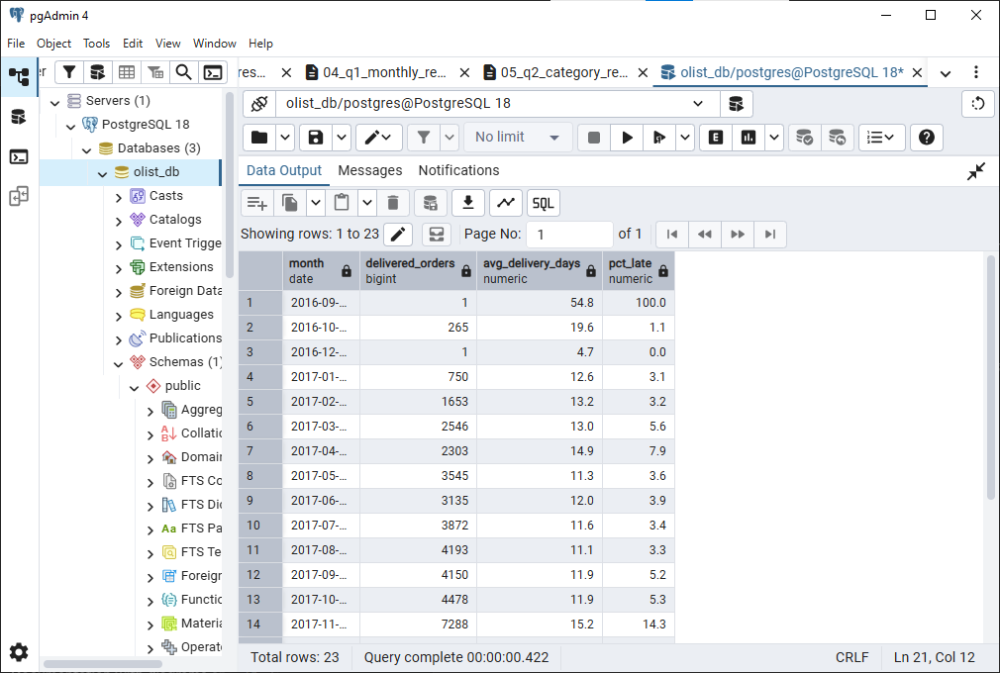

### Q4: Do late deliveries get lower review scores?
See `07_q4_reviews.sql`.

**Method:** Delivered orders that have a delivery date and a review (95,824 orders; 646 delivered orders with no review are excluded). The `order_reviews_clean` view is used so each order has exactly one review (the latest). An order is late if it arrived after the estimated delivery date.

**Finding:** On-time or early orders (88,163) averaged 4.29 stars, with 9.2% giving 1 or 2 stars and 62.4% giving 5 stars. Late orders (7,661) averaged 2.57 stars, with 54.1% giving 1 or 2 stars and 22.2% giving 5 stars. The score falls as the delay grows: 3.77 for orders up to 3 days late (2,636 orders), 2.32 for 3 to 7 days late (1,773 orders) and 1.73 for more than 7 days late (3,252 orders). The biggest single drop is between the first and second late groups. Late delivery and low review scores go together, but the data alone cannot show that lateness caused the low scores, since late orders may have other problems as well.

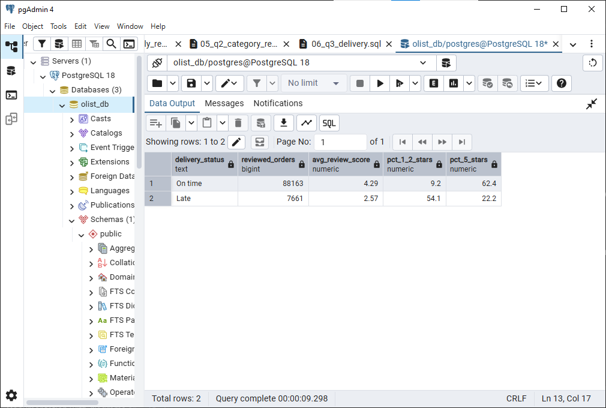
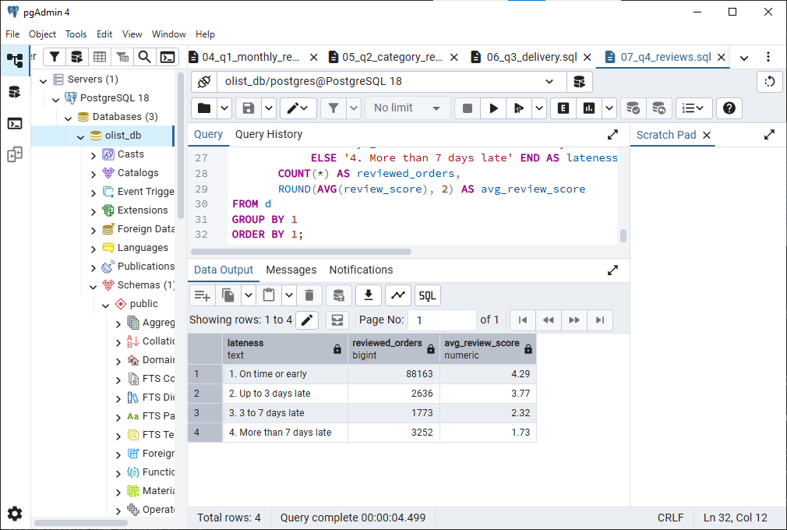

### Q5: Which payment methods do customers use?
See `08_q5_payments.sql`.

**Method:** Delivered orders only. An order can be paid with more than one method, so the per-method order shares add up to more than 100%. Payment values include freight, so they do not match the item-only revenue in Q1 and Q2. Installments are counted per credit card payment.

**Finding:** Credit card is the most used method, with 74,304 orders (77.0% of delivered orders) and 78.5% of total payment value. Next is boleto (a Brazilian bank-slip payment method) with 19,191 orders (19.9% of orders, 18.0% of value), then voucher with 3,679 orders (3.8%, 2.2% of value) and debit card with 1,485 orders (1.5%, 1.4% of value). The order shares add up to 102.2% because some orders were paid with more than one method (vouchers had 5,493 payments across 3,679 orders). About two thirds of credit card payments (66.8%) were split into more than one installment: 33.2% used one installment, 29.8% used 2 to 3, 21.2% used 4 to 6 and 15.8% used 7 or more. The average payment value rises with the number of installments, from about 96 for one installment to about 332 for 7 or more. The data alone cannot show why.

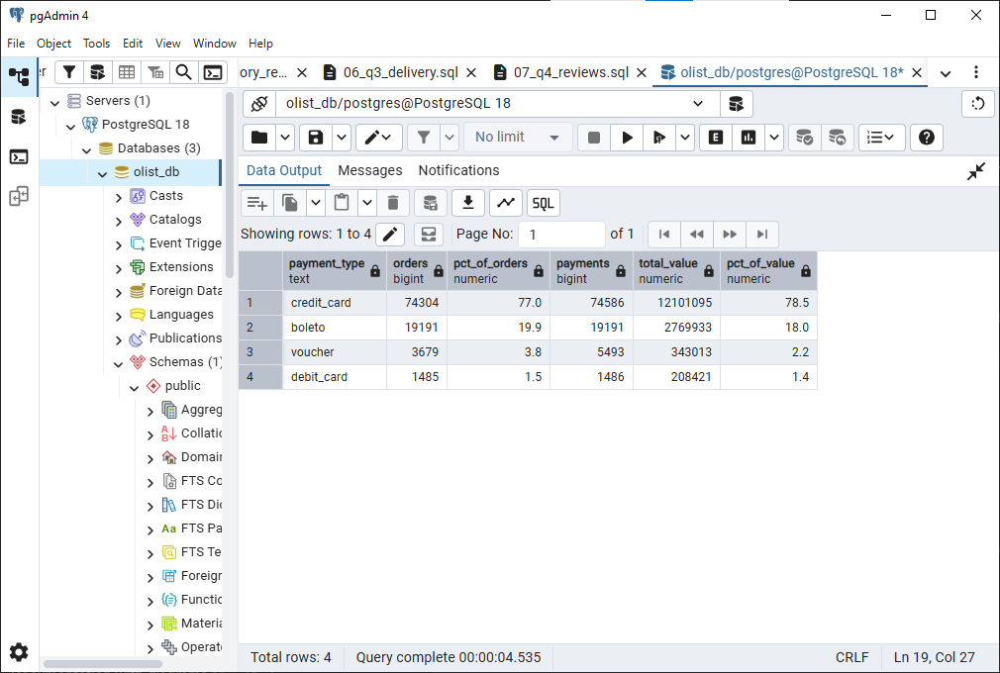
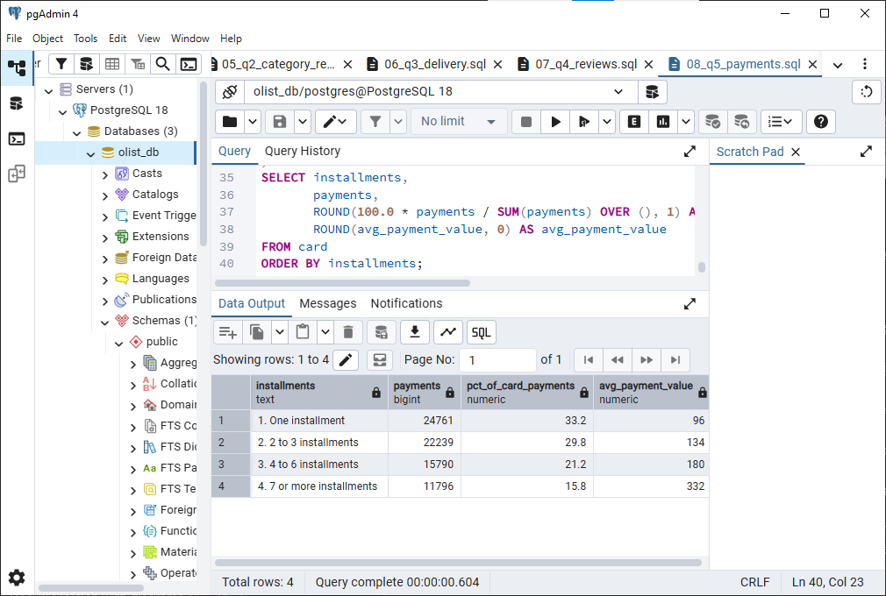

### Q6: How many customers order more than once?
See `09_q6_repeat_customers.sql`.

**Method:** Delivered orders only. Customers are identified by `customer_unique_id`, because every order gets its own `customer_id` in this dataset. The data covers Sep 2016 to Aug 2018, so a repeat purchase outside that period is not seen.

**Finding:** 93,358 customers placed delivered orders. Of these, 90,557 (97.0%) ordered once, 2,573 (2.8%) ordered twice, 181 (0.2%) ordered three times and 47 (0.1%) ordered four or more times. In total 2,801 customers (3.0%) are repeat customers, and they account for 6.1% of the 96,478 delivered orders. The data alone cannot show why so few customers came back.

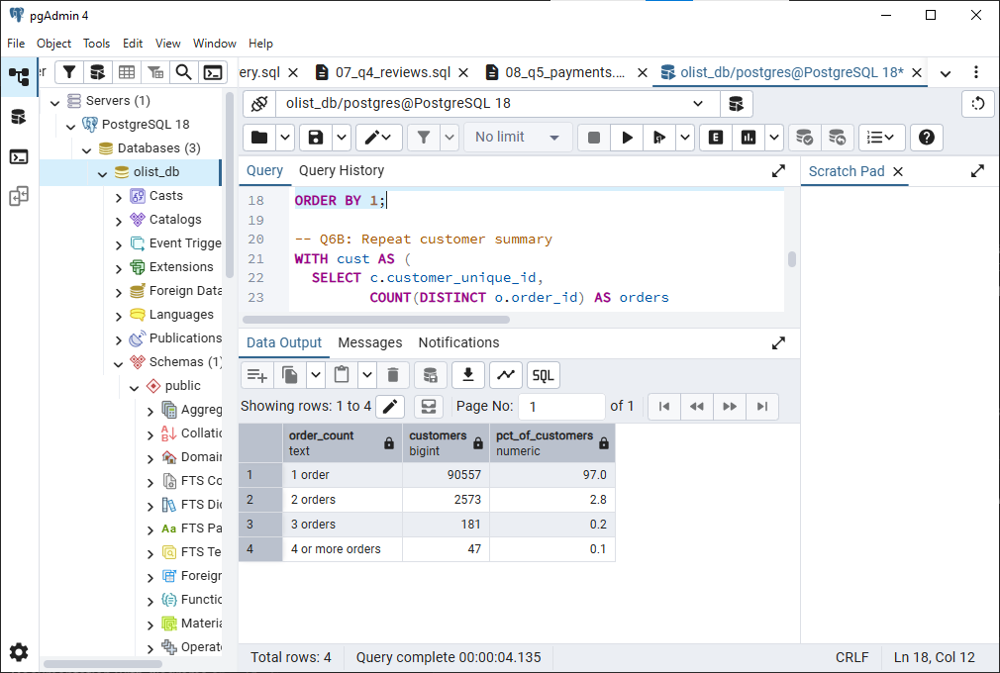
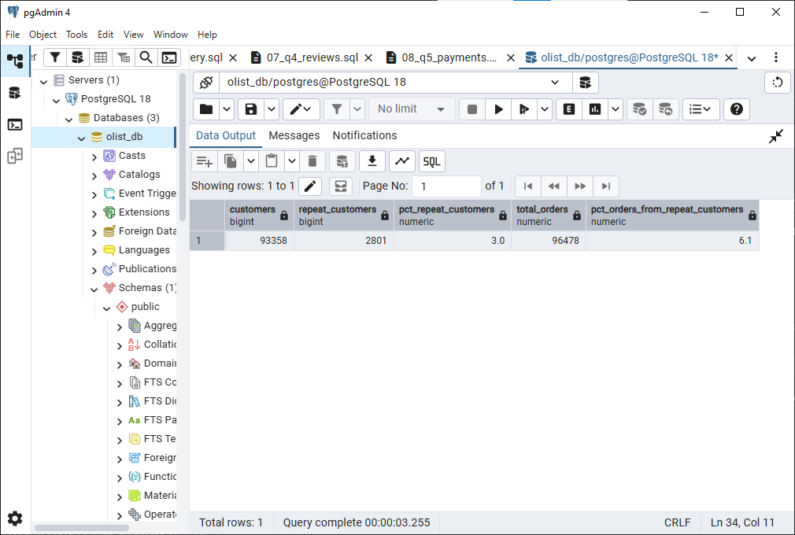

## Dashboard

A one-page Power BI dashboard built from custom SQL queries on `olist_db` (Import mode).

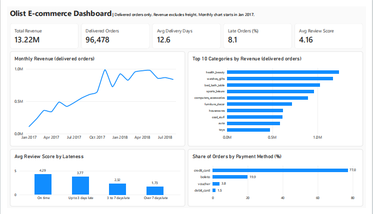

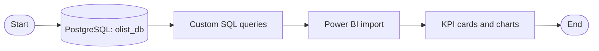

| KPI | Value |
|---|---|
| Total revenue (item price, excluding freight) | 13.22M |
| Delivered orders | 96,478 |
| Average delivery time (days) | 12.6 |
| Late orders | 8.1% |
| Average review score | 4.16 |

**Charts**

- Monthly revenue, Jan 2017 to Aug 2018
- Top 10 categories by revenue
- Average review score by lateness group
- Share of orders by payment method

**Notes**

- All figures cover delivered orders only.
- The monthly chart starts in Jan 2017. The total revenue card has no date filter.
- Delivery time and late share use only orders with a delivery date.
- The review score uses the latest review per order.
- Payment shares can total more than 100% because an order can use more than one payment method.

Files: [`olist_dashboard.pbix`](olist_dashboard.pbix), [lateness query](10_dashboard_review_lateness.sql), [payment query](11_dashboard_payment_methods.sql), [KPI query](12_dashboard_kpis.sql)

## Dashboard

A one-page Power BI dashboard built from custom SQL queries on `olist_db` (Import mode).

| KPI | Value |
|---|---|
| Total revenue (item price, excluding freight) | 13.22M |
| Delivered orders | 96,478 |
| Average delivery time (days) | 12.6 |
| Late orders | 8.1% |
| Average review score | 4.16 |

**Charts**

- Monthly revenue, Jan 2017 to Aug 2018
- Top 10 categories by revenue
- Average review score by lateness group
- Share of orders by payment method

**Notes**

- All figures cover delivered orders only.
- The monthly chart starts in Jan 2017. The total revenue card has no date filter.
- Delivery time and late share use only orders with a delivery date.
- The review score uses the latest review per order.
- Payment shares can total more than 100% because an order can use more than one payment method.

Files: [`olist_dashboard.pbix`](olist_dashboard.pbix), [lateness query](10_dashboard_review_lateness.sql), [payment query](11_dashboard_payment_methods.sql), [KPI query](12_dashboard_kpis.sql)

## Recommendations

These are suggested actions based on the six findings. The findings are descriptive: they show patterns and associations, not proven causes.

| Area | Finding | Suggested action | Limit |
|---|---|---|---|
| Revenue | Monthly revenue rose from 111,798 (Jan 2017) to a peak of 987,765 (Nov 2017), then ranged from about 826K to 978K in 2018. Revenue per order stayed about 124 to 149. | Track order count and revenue per order separately, with attention to order volume. | The analysis does not explain why order volume changed. |
| Categories | The top 10 categories earn about 62% of revenue, led by health_beauty (9.3%), watches_gifts (8.8%) and bed_bath_table (7.7%). | Monitor product availability and seller coverage in these categories first. | Profit and stock levels were not analysed. |
| Delivery | About 8.1% of orders were late. Monthly late share reached 14.3% (Nov 2017), 16.0% (Feb 2018) and 21.4% (Mar 2018). | Investigate what happened in these months and monitor late share monthly. | Causes of the delays were not analysed. |
| Reviews | On-time orders averaged 4.29 stars and late orders 2.57. Orders over 7 days late averaged 1.73. | Prioritise reducing long delays, and test early updates to customers whose orders are at risk. | Lateness is associated with lower scores; this does not prove it caused them. Customer updates were not studied. |
| Payments | Credit cards were used in 77.0% of orders and boleto in 19.9%. 66.8% of card payments used more than one installment. Average payment was about 96 for one installment and 332 for 7 or more. | Keep card, installment and boleto options working reliably. | Larger payments go with more installments; this does not show installments increase spending. |
| Retention | 97.0% of customers ordered once. The 3.0% who repeated placed 6.1% of orders. | Test a follow-up campaign for first-time buyers and compare repeat rates with a control group. | The data does not show why customers did not return. |

## Next Steps (planned)

- Compare late delivery share by customer state.
- Compare repeat purchase rates by product category.
