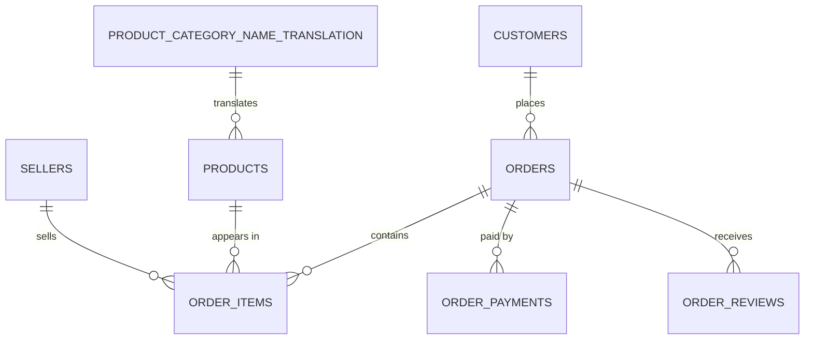
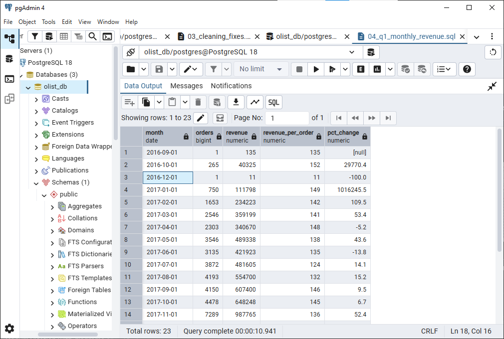
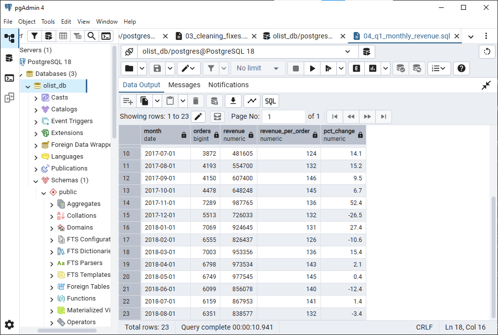

# Olist E-Commerce Analysis (SQL)

SQL analysis of the Olist Brazilian e-commerce dataset using PostgreSQL.

## Dataset
- Source: Kaggle, "Brazilian E-Commerce Public Dataset by Olist"
- 9 CSV files; 8 are loaded so far (the geolocation file is not used yet)
- Rows: orders 99,441, customers 99,441, order_items 112,650, order_payments 103,886, order_reviews 99,224, products 32,951, sellers 3,095, category translations 71

## Tools
PostgreSQL 18, pgAdmin 4

## Project Workflow

## How the Tables Connect

## Files
- `01_create_tables.sql`: table definitions
- `02_data_cleaning.sql`: data quality checks
- `03_cleaning_fixes.sql`: fixes for the problems found

## Data Quality Checks and Fixes

**1. Repeated review IDs** (`check1.png`, `check5.png`)
99,224 review rows have only 98,410 unique review IDs, and 547 orders have more than one review. Fix: the view `order_reviews_clean` keeps the latest review per order, giving 98,673 orders with exactly one review each (`verify1.png`).

**2. Missing delivery dates** (`check2.png`)
Orders by status: delivered 96,478, shipped 1,107, canceled 625, unavailable 609, invoiced 314, processing 301, created 5, approved 2. Most orders that were not delivered have no delivery date, which is expected. Two oddities: 8 delivered orders have no delivery date, and 6 canceled orders do have one. Handling: delivery-time analysis will use only delivered orders that have a delivery date.

**3. Product categories without English names** (`check3.png`)
610 products (about 1.9%) have no category at all, and 13 products belong to 2 categories with no translation (`portateis_cozinha_e_preparadores_de_alimentos` and `pc_gamer`). Fix: added the two missing translations, translated manually (`verify2.png`). The 610 uncategorized products will be labeled `unknown` inside queries.

**4. Order items without a matching order** (`check4.png`)
None found (0 orphan items).

## Business Questions

### Q1: How do revenue and orders change month by month?
See `04_q1_monthly_revenue.sql`.

**Method:** Delivered orders only. Revenue is the sum of item prices in Brazilian reais, excluding freight. Each order is counted once with `COUNT(DISTINCT order_id)`.

**Finding:** The data has only three months in 2016 (Sep, Oct and Dec, with 1, 265 and 1 orders, and none in Nov), so those months and the percentage changes around them (over 1,000,000% in Jan 2017) are not meaningful. From Jan 2017, orders grew from 750 to 7,069 in Jan 2018, and revenue from about 112K to about 925K. The peak month was Nov 2017 with 7,289 orders and 987,765 in revenue (+52.4% on Oct 2017), followed by a 26.5% drop in Dec 2017. The data alone cannot explain the November spike. From Jan to Aug 2018, monthly revenue stayed between about 826K and 978K, so growth leveled off. Revenue per order stayed between about 124 and 149 from Jan 2017 on, so growth came from more orders rather than larger orders. Delivered orders in the data end in Aug 2018.

### Still to do (planned)
2. Which product categories earn the most revenue?
3. How long does delivery take, and what share of orders arrive late?
4. Do late deliveries get lower review scores?
5. Which payment methods do customers use?
6. How many customers order more than once (using `customer_unique_id`)?

*Results and a dashboard will be added as each question is completed.*

